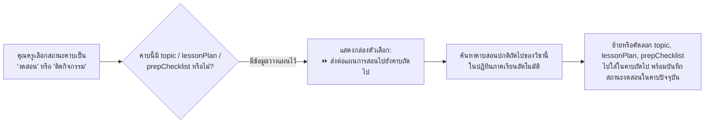

# ⏩ แผนแนวคิด: ส่งต่อหัวข้อบทเรียนและแผนการสอนอัตโนมัติเมื่อกด "งดสอน/ติดกิจกรรม" (Auto-Shift Lesson Plan)

> **สถานะ**: บันทึกแนวคิดและแผนการพัฒนา (Idea & Implementation Plan) — รอผู้ใช้งานสั่งเริ่มพัฒนา  
> **วันที่บันทึก**: 4 พฤศจิกายน 2026  
> **โปรเจกต์**: EDcalendar (Teaching Schedule & Calendar Management)

---

## 🎯 1. ที่มาและปัญหาที่ต้องการแก้ไข (Problem & Goal)

เมื่อคุณครูวางแผนการสอนล่วงหน้าโดยกรอก **`หัวข้อบทเรียน (topic)`**, **`รายละเอียดแผนการสอน (lessonPlan)`**, **`เช็กลิสต์สื่อ (prepChecklist)`** หรือ **`โน้ตช่วยจำ (notes)`** ไว้ในคาบเรียนใดคาบหนึ่ง แล้วต่อมาในวันนั้นเกิดเหตุการณ์ไม่คาดคิด เช่น **ติดกิจกรรมโรงเรียน** หรือ **ติดราชการต้องงดสอน**:
* **ปัญหาเดิม**: คุณครูต้องเสียเวลาคัดลอกข้อความหัวข้อบทเรียนและรายการเตรียมสื่อจากคาบที่งดสอน ไปเปิดหาคาบถัดไปของวิชานั้นในปฏิทินเพื่อวางข้อมูลใหม่ด้วยตนเอง
* **เป้าหมาย**: เพิ่มปุ่มลัดและระบบอัตโนมัติใน [`SessionDetailModal.jsx`](file:///w:/Ai/EDcalendar/src/components/Calendar/SessionDetailModal.jsx) ให้สามารถ **"ส่งต่อ (Shift / Push) แผนการสอนและเช็กลิสต์สื่อไปยังคาบเรียนถัดไปของวิชานี้"** ได้ในคลิกเดียว

---

## 💡 2. รูปแบบการทำงานและประสบการณ์ผู้ใช้ (User Experience & Workflow)

### 2.1 การตรวจจับคาบเรียนถัดไปของรายวิชาเดียวกัน (`findNextAvailableSessionForSubject`)
* เมื่ออยู่ในคาบเรียนวันที่ `D` ของวิชา `subjectId`:
  1. ระบบจะไล่วันเรียนตั้งแต่วันถัดไป (`D + 1` จนถึง `semester.endDate`)
  2. เรียกใช้ `getSessionsForDate` เพื่อหาคาบเรียนแรกของ `subjectId` เดียวกันที่มีสถานะเป็น `normal` (ไม่ใช่วันหยุดหรือวันที่งดสอนไปแล้ว)
  3. แสดงตัวอย่างวันที่และเวลาของคาบถัดไปให้คุณครูเห็นทันที เช่น:
     > *"พบคาบถัดไปของวิชานี้: **วันจันทร์ที่ 9 พ.ย. 2569 (09:30 - 10:20 น.)** — ต้องการส่งต่อหัวข้อบทเรียนและเช็กลิสต์สื่อไปยังคาบดังกล่าวหรือไม่?"*

### 2.2 ตัวเลือกโหมดการส่งต่อ (Shift Options)
1. **ส่งต่อไปยังคาบถัดไปทันที (Single-Step Shift)**:
   * ย้าย `topic`, `lessonPlan`, `prepChecklist` จากคาบที่งดสอน ไปยังคาบเรียนปกติถัดไปของวิชานั้น
2. **เลื่อนแบบลูกโซ่ (Cascade Shift — กรณีวางแผนล่วงหน้าหลายคาบ)**:
   * หากคาบถัดไปมีหัวข้อบทเรียนเขียนรอไว้อยู่แล้ว ระบบจะถามว่าต้องการ **"เลื่อนต่อกันเป็นลูกโซ่ (Cascade)"** หรือ **"รวมหัวข้อเข้าด้วยกัน (Merge)"** เพื่อไม่ให้ข้อมูลที่วางแผนไว้เดิมถูกเขียนทับโดยไม่ตั้งใจ

---

## 🛠️ 3. รายการไฟล์ที่จะแก้ไขเมื่อเริ่มพัฒนา (Files to Modify)

1. **[`src/services/calendarGenerator.js`](file:///w:/Ai/EDcalendar/src/services/calendarGenerator.js)**
   * เพิ่มฟังก์ชัน `findNextSessionForSubject(fromDateStr, slotId, subjectId, semester, slots, subjects, overrides, multiDayEvents)` สำหรับค้นหาคาบเรียนปกติถัดไปของรายวิชานั้น
2. **[`src/components/Calendar/SessionDetailModal.jsx`](file:///w:/Ai/EDcalendar/src/components/Calendar/SessionDetailModal.jsx)**
   * เมื่อ `status === 'cancelled' || status === 'activity'` และมีข้อมูล `topic`, `lessonPlan` หรือ `prepChecklist` อยู่ ให้แสดงแถบตัวเลือก **"⏩ ส่งต่อหัวข้อบทเรียนและสื่อการสอนไปยังคาบถัดไป"** พร้อมระบุวันที่ของคาบเป้าหมายชัดเจน
3. **[`src/App.jsx`](file:///w:/Ai/EDcalendar/src/App.jsx)**
   * รองรับการบันทึก Override หลายรายการพร้อมกัน (บันทึกสถานะงดสอนในคาบปัจจุบัน + บันทึกแผนการสอนที่ส่งต่อไปยังคาบถัดไป)
