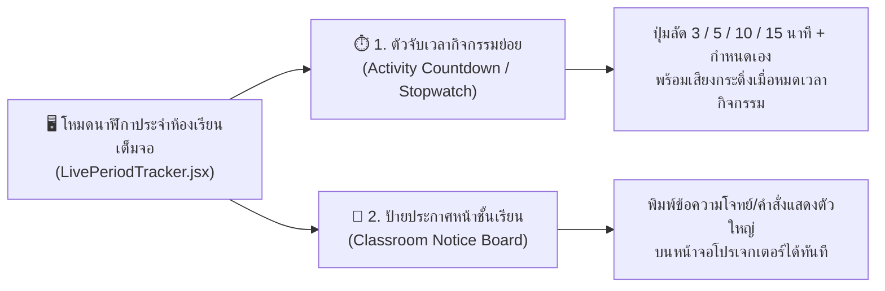

# 🧰 แผนแนวคิด: เครื่องมือหน้าห้องเรียนเสริมในโหมดนาฬิกาเต็มจอ (Classroom Mini-Toolkit)

> **สถานะ**: บันทึกแนวคิดและแผนการพัฒนา (Idea & Implementation Plan) — รอผู้ใช้งานสั่งเริ่มพัฒนา  
> **วันที่บันทึก**: 4 พฤศจิกายน 2026  
> **โปรเจกต์**: EDcalendar (Teaching Schedule & Calendar Management)

---

## 🎯 1. ที่มาและวัตถุประสงค์ (Vision & Goal)

เมื่อคุณครูเปิดโหมด **นาฬิกาประจำห้องเรียนเต็มจอ** ([`LivePeriodTracker.jsx`](file:///w:/Ai/EDcalendar/src/components/Timetable/LivePeriodTracker.jsx)) ฉายขึ้นจอโปรเจกเตอร์หรือสมาร์ททีวีหน้าชั้นเรียน ขณะให้นักเรียนทำแบบฝึกหัด สอบย่อย หรือทำงานกลุ่ม:
* นอกจากนักเรียนจะต้องการดูเวลาคาบเรียนหลักแล้ว คุณครูมักต้องการ **"ตั้งเวลาสำหรับกิจกรรมย่อยในคาบ"** (เช่น ให้เวลาทำควิซ 10 นาที หรืออภิปรายกลุ่ม 15 นาที) และต้องการ **"ขึ้นข้อความประกาศตัวใหญ่ๆ บนกระดาน"** (เช่น โจทย์งาน หน้าหนังสือที่ต้องเปิด หรือกติกาการสอบ)
* จึงต่อยอดโหมดนาฬิกาเต็มจอให้มี **Classroom Mini-Toolkit** ที่เปิด–ปิดซ่อนได้โดยไม่บดบังนาฬิกาหลัก

---

## 💡 2. องค์ประกอบของ Classroom Mini-Toolkit (Key Features)

### 2.1 ตัวจับเวลากิจกรรมย่อยในคาบ (Mini Activity Timer & Stopwatch)
* ทำงานแยกอิสระจากเวลาคาบเรียนหลัก (นาฬิกาคาบเรียนหลักยังคงแสดงเวลาเริ่มและเวลาเหลือของคาบตามปกติ)
* **ปุ่มตั้งเวลาด่วน (Quick Presets)**:
  * `[ 3 นาที ]` `[ 5 นาที ]` `[ 10 นาที ]` `[ 15 นาที ]` `[ 20 นาที ]` หรือพิมพ์นาทีเอง
* **ปุ่มควบคุม**: `▶️ เริ่ม` / `⏸️ หยุดชั่วคราว` / `🔄 รีเซ็ต` / `+1 นาที`
* **การแจ้งเตือนเมื่อหมดเวลากิจกรรม**:
  * เมื่อตัวเลขถอยหลังถึง `00:00` กรอบตัวจับเวลากิจกรรมจะกะพริบสีแดง/เหลืองเด่นชัด พร้อมส่งเสียงกระดิ่งเตือน (ใช้ `playClassroomChime` จาก [`wakeLockUtils.js`](file:///w:/Ai/EDcalendar/src/utils/wakeLockUtils.js))

### 2.2 ป้ายประกาศหน้าจอโปรเจกเตอร์ (Classroom Notice / Instruction Banner)
* มีปุ่ม **`📌 ขึ้นป้ายประกาศหน้าห้อง`** บนแถบเครื่องมือด้านบนของโหมดเต็มจอ
* เมื่อเปิดใช้งาน คุณครูสามารถพิมพ์ข้อความคำสั่งหรือโจทย์สั้นๆ ได้ทันที เช่น:
  * *"📝 ทำแบบฝึกหัดท้ายบทที่ 2 (หน้า 45 ข้อ 1–5) ส่งก่อนหมดคาบ 5 นาที"*
  * *"🤫 กำลังสอบย่อย 15 นาที — ห้ามใช้เครื่องคิดเลขและโทรศัพท์มือถือ"*
* ข้อความจะแสดงเป็นกล่องป้ายประกาศขนาดใหญ่ ตัวอักษรคมชัด อ่านง่ายจากหลังห้องเรียน และสามารถแก้ไขสดๆ บนหน้าจอได้ทันที

---

## 🛠️ 3. รายการไฟล์ที่จะแก้ไขเมื่อเริ่มพัฒนา (Files to Modify)

1. **[`src/components/Timetable/LivePeriodTracker.jsx`](file:///w:/Ai/EDcalendar/src/components/Timetable/LivePeriodTracker.jsx)**
   * เพิ่มปุ่มเปิด–ปิด **`⏱️ จับเวลากิจกรรม`** และ **`📌 ป้ายประกาศ`** บนแถบควบคุมด้านบนของโหมดเต็มจอ
   * เพิ่มคอมโพเนนต์ย่อยสำหรับการ์ดจับเวลากิจกรรมและกล่องป้ายประกาศหน้าชั้นเรียนในโหมด Fullscreen Overlay
2. **[`src/utils/wakeLockUtils.js`](file:///w:/Ai/EDcalendar/src/utils/wakeLockUtils.js)**
   * เพิ่มเสียงกระดิ่งเฉพาะสำหรับเมื่อหมดเวลากิจกรรมย่อย (`playClassroomChime('activity_end')`)
