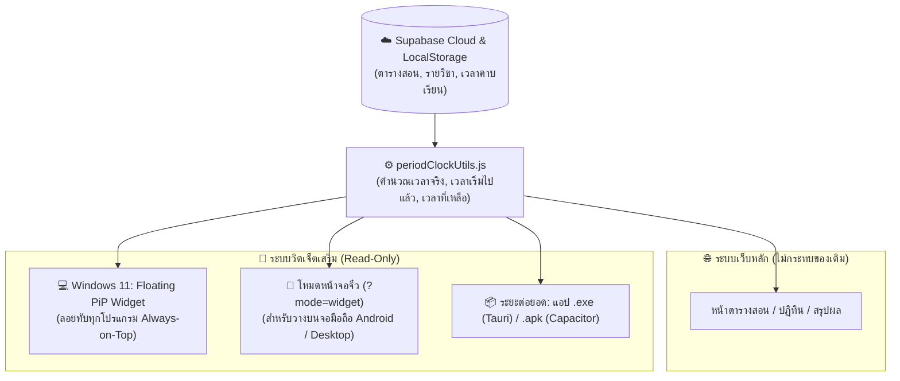

# 🧩 แผนแนวคิด: พัฒนาระบบวิดเจ็ตนาฬิกาและคาบเรียนสำหรับหน้าจอ Windows 11 และมือถือ Android (Cross-Platform Live Widget)

> **สถานะ**: บันทึกแนวคิดและแผนการพัฒนา (Idea & Implementation Plan) — ยังไม่เริ่มดำเนินการเขียนโค้ด  
> **วันที่บันทึก**: 3 พฤศจิกายน 2026  
> **โปรเจกต์**: EDcalendar (Teaching Schedule & Calendar Management)

---

## 🎯 1. วัตถุประสงค์ (Goal & Vision)

ต่อยอดระบบ **นาฬิกา Real-time และตัวจับเวลาคาบเรียน** ของ EDcalendar ให้สามารถแสดงผลเป็น **วิดเจ็ตขนาดกะทัดรัด (Live Compact Widget)** บนหน้าจอหลักของผู้ใช้งานได้ทั้ง 2 อุปกรณ์ โดย **ไม่กระทบหรือทำให้ระบบเว็บหลักเดิมเสียหาย**:
1. **บนคอมพิวเตอร์ Windows 11**: ลอยอยู่มุมหน้าจอ Desktop หรือทับหน้าต่างโปรแกรมสอน (เช่น PowerPoint, Canva, PDF) เพื่อดูเวลาปัจจุบัน เวลาที่เริ่มคาบไปแล้ว และเวลาที่เหลือได้ตลอดเวลา
2. **บนสมาร์ทโฟน Android**: แสดงเป็นวิดเจ็ตบนหน้าจอโฮม (Home Screen) เพื่อให้หยิบมือถือขึ้นมาดูได้ทันทีว่าตอนนี้อยู่คาบไหน เหลือกี่นาที กี่วินาที และต้องสอนห้องไหน

---

## 🛡️ 2. หลักการออกแบบให้ "ระบบเว็บเดิมปลอดภัย 100%" (Zero-Risk Architecture)

* **แยกโหมดการแสดงผล (`?mode=widget`)**:
  * ระบบเว็บหลัก ([`App.jsx`](file:///w:/Ai/EDcalendar/src/App.jsx), [`TimetableGrid.jsx`](file:///w:/Ai/EDcalendar/src/components/Timetable/TimetableGrid.jsx), [`TeachingCalendar.jsx`](file:///w:/Ai/EDcalendar/src/components/Calendar/TeachingCalendar.jsx)) ยังคงทำงานตามปกติทุกประการ
  * เพิ่มเฉพาะคอมโพเนนต์ `CompactWidgetView.jsx` ที่จะทำงานเฉพาะเมื่อเปิดผ่านพารามิเตอร์ `?mode=widget` หรือเปิดผ่านหน้าต่าง Picture-in-Picture เท่านั้น
* **อ่านข้อมูลอย่างเดียว (Read-Only State)**:
  * วิดเจ็ตทำหน้าที่อ่านค่าเวลาคาบเรียน ([`periodConfig.js`](file:///w:/Ai/EDcalendar/src/utils/periodConfig.js)) และข้อมูลตารางสอนจาก LocalStorage / Supabase Cloud ([`supabaseClient.js`](file:///w:/Ai/EDcalendar/src/services/supabaseClient.js)) โดยไม่ไปแก้ไขหรือเขียนทับข้อมูลตารางสอน

---

## 💻 3. แนวทางการพัฒนาบน Windows 11 Desktop

### แนวทางที่ 1: วิดเจ็ตลอยทับหน้าจอผ่านเบราว์เซอร์ (Document Picture-in-Picture / PWA Mini Window) — *ระยะที่ 1 (แนะนำเริ่มก่อน)* ⭐⭐⭐⭐⭐
* **เทคโนโลยี**: HTML5 Document Picture-in-Picture API (รองรับใน Chrome และ Microsoft Edge บน Windows 11) + Fallback เป็น Popup Mini Window
* **รูปแบบการทำงาน**:
  1. มีปุ่ม **"📌 เปิดวิดเจ็ตลอย (Pin Desktop Widget)"** บนการ์ดนาฬิกาและบนแถบเมนูด้านบน
  2. เมื่อกดปุ่ม จะเด้งหน้าต่างขนาดเล็กไร้ขอบเมนู (เช่น ขนาด `340 x 180 px`) ลอยขึ้นมาบนหน้าจอ Windows 11
  3. หน้าต่างนี้มีคุณสมบัติ **Always on Top (ลอยทับโปรแกรมอื่นเสมอ)** แม้คุณครูจะเปิดสไลด์ PowerPoint เต็มจอหรือเปิดเอกสารสอน วิดเจ็ตก็ยังแสดงเวลาแบบวินาทีต่อวินาทีอยู่มุมจอ
* **ข้อดี**: ไม่ต้องติดตั้งโปรแกรม `.exe` เพิ่มเติม ใช้งานจากเว็บเดิมได้ทันที

### แนวทางที่ 2: โปรแกรม Desktop Widget แท้สำหรับ Windows 11 (`.exe` ด้วย Tauri) — *ระยะต่อยอด* ⭐⭐⭐⭐
* **เทคโนโลยี**: **Tauri** (ห่อหน้า `?mode=widget` เป็นไฟล์ `.exe` ขนาดเล็กเพียง ~5 MB)
* **รูปแบบการทำงาน**:
  * แสดงเป็นวิดเจ็ตกรอบใสไร้ขอบ (Frameless Transparent Window) เกาะอยู่บนพื้นหลัง Desktop ของ Windows 11
  * ตั้งค่าให้เปิดทำงานอัตโนมัติพร้อม Windows (Auto-start on Boot)

---

## 📱 4. แนวทางการพัฒนาบนมือถือ Android

### แนวทางที่ 1: โหมด Web Widget (`?mode=widget`) คู่กับแอป Web Widget บน Android — *ระยะที่ 1 (ทำได้ทันทีไม่ต้องสร้างไฟล์ `.apk`)* ⭐⭐⭐⭐⭐
* **รูปแบบการทำงาน**:
  1. ออกแบบหน้า `?mode=widget` ให้มีขนาดยืดหยุ่นพอดีกับกรอบสี่เหลี่ยมของวิดเจ็ตมือถือ (เช่น ขนาด `4x2` หรือ `4x1` ช่อง)
  2. บนมือถือ Android ใช้แอปฟรีจาก Google Play Store เช่น **Web Widget** หรือ **Widgetify** ดึง URL `https://.../index.html?mode=widget` ไปวางบนหน้าจอโฮม
* **ข้อดี**: ไม่ต้องเขียนโค้ด Android แยก ไม่ต้องคอยติดตั้งไฟล์ `.apk` ใหม่เมื่อมีการอัปเดตระบบ

### แนวทางที่ 2: แอปพลิเคชัน Android (`.apk`) พร้อม Native Home Screen Widget — *ระยะต่อยอด* ⭐⭐⭐⭐
* **เทคโนโลยี**: **Capacitor** + Native Android `AppWidgetProvider` & `Chronometer`
* **รูปแบบการทำงาน**:
  * แปลงโปรเจกต์ React เป็นแอป Android (`.apk`)
  * ใช้คอมโพเนนต์ `Chronometer` ของระบบปฏิบัติการ Android เพื่อให้วิดเจ็ตบนหน้าจอโฮมสามารถเดินตัวเลข **นาที:วินาที** แบบ Real-time ทั้งขาขึ้น (เวลาที่เริ่มคาบไปแล้ว) และขาลง (เวลาที่เหลือในคาบ) ได้อย่างถูกต้องโดยไม่เปลืองแบตเตอรี่

---

## 🗺️ 5. แผนผังการทำงานรวม (Architecture Diagram)

---

## 🛠️ 6. ขั้นตอนการพัฒนาเมื่อพร้อมเริ่มงาน (Implementation Roadmap)

* **เฟสที่ 1: สร้างโหมดหน้าจอวิดเจ็ตขนาดจิ๋ว (`src/components/Widget/CompactClockWidget.jsx`)**
  * รองรับการเปิดผ่าน URL `?mode=widget`
  * ออกแบบ UI ขนาดกะทัดรัด อ่านง่าย แสดงครบทั้ง: เวลาปัจจุบัน (`HH:MM:SS`), คาบปัจจุบัน, เริ่มไปแล้ว `X นาที Y วินาที`, เหลืออีก `X นาที Y วินาที`, หลอดความคืบหน้า และชื่อวิชา/ห้องเรียน
* **เฟสที่ 2: เพิ่มปุ่ม "📌 เปิดวิดเจ็ตลอยบนหน้าจอ (Always-on-Top)" สำหรับ Windows 11**
  * ใช้ Document Picture-in-Picture API (พร้อมระบบสำรองเป็นหน้าต่าง Popup ขนาดจิ๋ว) ให้คุณครูกดแยกวิดเจ็ตออกมาลอยมุมจอคอมพิวเตอร์ได้ในคลิกเดียว
* **เฟสที่ 3: เพิ่มคู่มือ/ปุ่มคัดลอกลิงก์สำหรับตั้งเป็นวิดเจ็ตบนมือถือ Android และ PWA Manifest**
  * เพิ่มไฟล์ `manifest.json` เพื่อให้ติดตั้งเป็นแอปลงหน้าจอโฮมมือถือและ Windows 11 ได้ทันที
  * เพิ่มหน้าต่างแนะนำวิธีนำลิงก์ `?mode=widget` ไปวางบนหน้าจอโฮมของ Android
* **เฟสที่ 4 (ทางเลือกอนาคต): สร้างไฟล์ติดตั้ง `.exe` (Windows) และ `.apk` (Android)**
  * ใช้ Tauri และ Capacitor เมื่อต้องการแพ็กเกจเป็นไฟล์ติดตั้งแยกเต็มรูปแบบ
