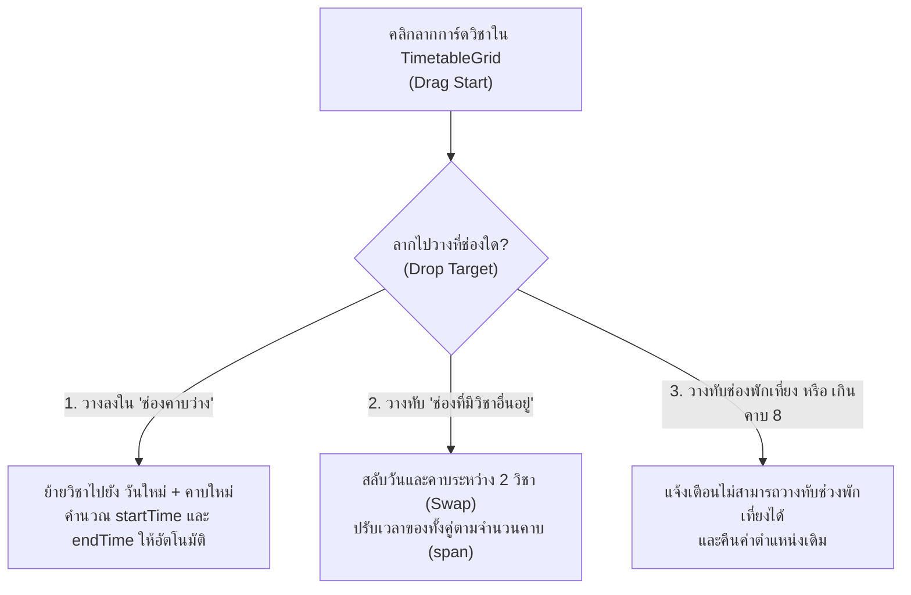

# 🖱️ แผนแนวคิด: ลากวางเพื่อย้ายหรือสลับคาบเรียนบนตารางสอน (Drag & Drop Timetable Slot Swapping)

> **สถานะ**: บันทึกแนวคิดและแผนการพัฒนา (Idea & Implementation Plan) — รอผู้ใช้งานสั่งเริ่มพัฒนา  
> **วันที่บันทึก**: 4 พฤศจิกายน 2026  
> **โปรเจกต์**: EDcalendar (Teaching Schedule & Calendar Management)

---

## 🎯 1. ที่มาและปัญหาที่ต้องการแก้ไข (Problem & Goal)

ในช่วงต้นภาคเรียนหรือเมื่อฝ่ายวิชาการมีการปรับเปลี่ยนตารางสอน:
* **ปัญหาเดิม**: หากคุณครูต้องการย้ายวิชาจาก *วันจันทร์ คาบ 1* ไปไว้ *วันพุธ คาบ 3* หรือสลับที่ระหว่าง 2 วิชา คุณครูต้องคลิกเปิดหน้าต่างแก้ไข (`SlotModal.jsx`) เพื่อเปลี่ยนวันและเวลาทีละวิชา
* **เป้าหมาย**: เพิ่มความสามารถ **ลากและวาง (HTML5 Drag & Drop)** บนตารางสอน [`TimetableGrid.jsx`](file:///w:/Ai/EDcalendar/src/components/Timetable/TimetableGrid.jsx) เพื่อให้สามารถคลิกลากวิชาไปวางในช่องว่างเพื่อ **ย้ายคาบ (Move)** หรือลากไปวางทับวิชาอื่นเพื่อ **สลับคาบ (Swap)** ได้ทันที

---

## 💡 2. รูปแบบการทำงานและตรรกะการย้าย/สลับคาบ (Interaction & Logic)

### 2.1 กรณีลากไปวางใน "ช่องว่าง" (Move Slot)
* เมื่อลากวิชา `A` (สมมติว่าเป็นวิชา 1 คาบ หรือควบ 2 คาบ) ไปวางที่ `วันพฤหัสบดี คาบที่ 2`:
  * ระบบจะคำนวณ `dayOfWeek = 4`, `periodNumber = 2`
  * ดึง `startTime` ของคาบที่ 2 และ `endTime` ของคาบสุดท้ายตามจำนวนคาบที่วิชานั้นใช้ (`span`) จาก [`periodConfig.js`](file:///w:/Ai/EDcalendar/src/utils/periodConfig.js)
  * อัปเดตข้อมูล `slot` ทันทีพร้อมซิงค์ขึ้น Cloud

### 2.2 กรณีลากไปวางทับ "วิชาที่มีอยู่แล้ว" (Swap Slots)
* เมื่อลากวิชา `A` (วันจันทร์ คาบ 1) ไปวางทับวิชา `B` (วันอังคาร คาบ 4):
  * ระบบจะสลับตำแหน่งของวิชา `A` และวิชา `B` ทันที
  * คำนวณ `startTime` และ `endTime` ใหม่ให้ทั้งสองวิชาตามคาบปลายทาง

### 2.3 การแสดงผลขณะลาก (Visual Feedback)
* ช่องวิชาที่ถูกลากจะโปร่งแสงลงเล็กน้อย (`opacity-50 scale-95`)
* ช่องปลายทางที่เมาส์ลากผ่านจะแสดงเส้นขอบเรืองแสงสีคราม (`ring-2 ring-indigo-500 bg-indigo-50/50`) พร้อมป้ายเล็กๆ บอกว่า **"วางเพื่อย้ายมาคาบนี้"** หรือ **"วางเพื่อสลับวิชากัน"**

---

## 🛠️ 3. รายการไฟล์ที่จะแก้ไขเมื่อเริ่มพัฒนา (Files to Modify)

1. **[`src/components/Timetable/TimetableGrid.jsx`](file:///w:/Ai/EDcalendar/src/components/Timetable/TimetableGrid.jsx)**
   * เพิ่มสถานะ `draggedSlot` และ `dropTargetCell` (`{ dayId, periodNum }`)
   * ผูกอีเวนต์ `draggable`, `onDragStart`, `onDragOver`, `onDragLeave`, `onDrop` บนช่องตารางสอน
2. **[`src/App.jsx`](file:///w:/Ai/EDcalendar/src/App.jsx)**
   * เพิ่มฟังก์ชัน `handleMoveOrSwapSlots(sourceSlotId, targetDay, targetPeriod)` เพื่ออัปเดตทั้งย้ายเดี่ยวและสลับคู่ในครั้งเดียว
