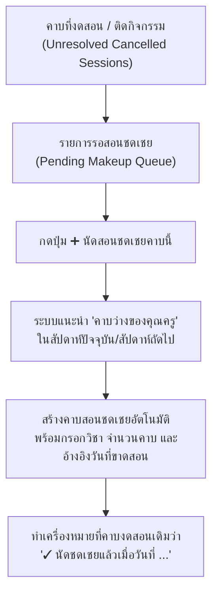

# 🔄 แผนแนวคิด: ระบบจับคู่และนัดสอนชดเชยด่วน (1-Click Makeup Class Matcher)

> **สถานะ**: บันทึกแนวคิดและแผนการพัฒนา (Idea & Implementation Plan) — รอผู้ใช้งานสั่งเริ่มพัฒนา  
> **วันที่บันทึก**: 4 พฤศจิกายน 2026  
> **โปรเจกต์**: EDcalendar (Teaching Schedule & Calendar Management)

---

## 🎯 1. ที่มาและปัญหาที่ต้องการแก้ไข (Problem & Goal)

เมื่อมีคาบเรียนที่ต้อง **งดสอน** หรือ **ติดกิจกรรม** ในระหว่างภาคเรียน คุณครูจำเป็นต้องหาเวลา **สอนชดเชย (Makeup Class)** เพื่อให้จำนวนคาบและเวลาเรียนครบตามโครงสร้างหลักสูตร:
* **ปัญหาเดิม**: คุณครูต้องจำหรือย้อนดูในประวัติการงดสอนว่าวิชาไหนขาดสอนของวันที่เท่าไหร่บ้าง แล้วต้องไปเปิดปฏิทินกดสร้างคาบพิเศษ เลือกวิชา ตั้งเวลา และพิมพ์เหตุผลอ้างอิงเองทั้งหมด
* **เป้าหมาย**: สร้างระบบ **"จับคู่คาบงดสอน -> นัดสอนชดเชยด่วน (1-Click Makeup Matcher)"** ที่ผูกความสัมพันธ์ระหว่างคาบที่ขาดกับคาบที่ชดเชย พร้อมแนะนำ **"ช่องคาบว่างของคุณครู"** ให้อัตโนมัติ

---

## 💡 2. รูปแบบการทำงานและฟีเจอร์หลัก (Key Features)

### 2.1 สถานะการชดเชยรายคาบ (Per-Session Makeup Tracking)
* คาบที่งดสอนแต่ละรายการจะมีสถานะย่อย:
  * 🔴 **ยังไม่ได้นัดชดเชย**: แสดงปุ่ม `➕ นัดวันสอนชดเชย`
  * 🟢 **ชดเชยเรียบร้อยแล้ว**: แสดงป้ายกำกับ `✓ ชดเชยแล้วเมื่อ [วันที่]` (เชื่อมโยงด้วย `makeupForSessionId` หรือ `makeupForDate`)

### 2.2 ตัวช่วยแนะนำ "คาบว่างของคุณครู" (Free Period Finder)
* เมื่อคุณครูกดปุ่ม `➕ นัดวันสอนชดเชย` ของวิชาใดวิชาหนึ่ง:
  * ระบบจะตรวจสอบตารางสอนของคุณครูในสัปดาห์ที่เลือก แล้วแสดงตัวเลือก **"คาบว่างที่แนะนำ"** เช่น:
    * `วันพุธที่ 11 พ.ย. • คาบที่ 3 (10:20 - 11:10 น.) — ว่าง`
    * `วันศุกร์ที่ 13 พ.ย. • คาบที่ 6 (14:40 - 15:30 น.) — ว่าง`
  * หรือเลือกวันที่และเวลาเองตามต้องการ
* กรอกข้อมูลให้อัตโนมัติครบถ้วน:
  * **วิชา**: ดึงจากคาบที่งดสอน
  * **ห้องเรียน**: ดึงห้องเรียนประจำวิชา
  * **สถานะ**: `สอนชดเชย (makeup)`
  * **รายละเอียดการสอนชดเชย (`reason`)**: กรอกอัตโนมัติว่า *"สอนชดเชยคาบที่งดสอนเมื่อวัน...ที่ ... ({สาเหตุเดิม})"*

---

## 🛠️ 3. รายการไฟล์ที่จะแก้ไขเมื่อเริ่มพัฒนา (Files to Modify)

1. **[`src/services/summaryService.js`](file:///w:/Ai/EDcalendar/src/services/summaryService.js)**
   * เพิ่มการตรวจสอบความเชื่อมโยงระหว่างคาบงดสอน (`cancelled`) กับคาบชดเชย (`makeup` ที่มี `makeupForId`) เพื่อแยกแยะว่าคาบงดสอนรายการใดได้รับการชดเชยแล้วหรือยังค้างอยู่
2. **[`src/components/Summary/TeachingSummary.jsx`](file:///w:/Ai/EDcalendar/src/components/Summary/TeachingSummary.jsx)**
   * ในตาราง *บันทึกประวัติการงดสอนและกิจกรรม* เพิ่มปุ่ม **`➕ นัดสอนชดเชย`** ท้ายแถวรายการที่ยังไม่ได้ชดเชย และแสดงป้าย `✓ ชดเชยแล้ว` สำหรับรายการที่นัดชดเชยแล้ว
3. **[`src/components/Calendar/SessionDetailModal.jsx`](file:///w:/Ai/EDcalendar/src/components/Calendar/SessionDetailModal.jsx)**
   * รองรับการเปิดโหมดสร้างคาบสอนชดเชยพร้อมค่าเริ่มต้นที่ส่งมาจากคาบงดสอน และแสดงตัวเลือก **"คาบว่างในตารางสอนของคุณครู"** ให้คลิกเลือกเวลาได้ทันที
