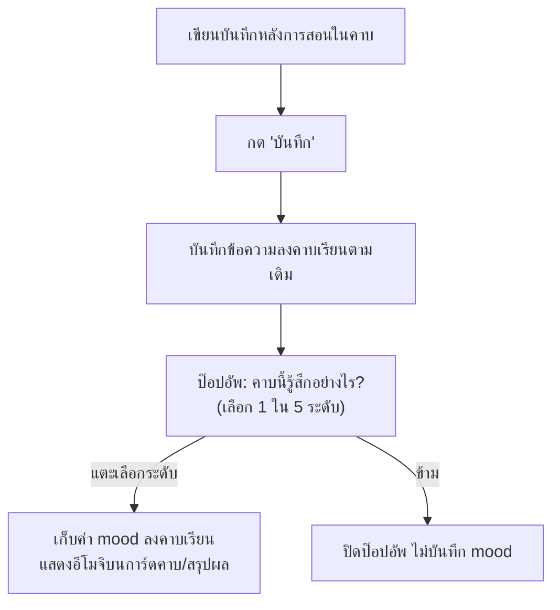

# 😊 แผนแนวคิด: ป๊อปอัพบันทึกอารมณ์ของคาบเรียนหลังบันทึกหลังการสอน (Post-Class Mood Check)

> **สถานะ**: บันทึกแนวคิดและแผนการพัฒนา (Idea & Implementation Plan) — รอผู้ใช้งานสั่งเริ่มพัฒนา  
> **วันที่บันทึก**: 18 พฤศจิกายน 2026  
> **โปรเจกต์**: EDcalendar (Teaching Schedule & Calendar Management)

---

## 🎯 1. ที่มาและเป้าหมาย (Problem & Goal)

ปัจจุบันคุณครูเขียน **บันทึกหลังการสอน** เป็นข้อความอิสระได้ในแต่ละคาบ (เช่น ผลการเรียนรู้ ปัญหาที่พบ) แต่ยังไม่มีข้อมูลที่ **เทียบกันได้ง่ายและกรอกได้ในไม่กี่วินาที** ว่าคาบนั้น "รู้สึกอย่างไร"
* **เป้าหมาย**: หลังกดบันทึกข้อความหลังการสอน ให้มี **ป๊อปอัพถามอารมณ์ (Mood) ของคาบนี้** ให้เลือก 1 ใน 5 ระดับด้วยการแตะครั้งเดียว
* **ประโยชน์**: ย้อนดูภาพรวมได้ว่าวิชา/วัน/ห้องเรียนไหนที่คาบเรียนราบรื่นหรือติดขัด และใช้ประกอบการทบทวนการสอนหรือการเขียนรายงาน

---

## 💡 2. รูปแบบการทำงานและฟีเจอร์หลัก (Key Features)

### 2.1 ระดับอารมณ์ 5 ระดับ (ร่างเบื้องต้น — ปรับชื่อ/อีโมจิได้)

| ระดับ | ความหมาย | อีโมจิ (ร่าง) |
|:---:|---|:---:|
| 1 | ไม่โอเคมาก | 😣 |
| 2 | ไม่ค่อยโอเค | 🙁 |
| 3 | เฉย ๆ / ปกติ | 😐 |
| 4 | ดี | 🙂 |
| 5 | ดีจนเซอร์ไพรส์ | 🤩 |

### 2.2 พฤติกรรมของป๊อปอัพ
* ขึ้นหลังกดบันทึกข้อความหลังการสอนสำเร็จ (บันทึกข้อความก่อน แล้วค่อยถาม mood — ถ้าปิดป๊อปอัพ ข้อความก็ไม่หาย)
* แตะระดับเดียวแล้วปิดทันที ไม่ต้องกดยืนยันซ้ำ
* มีปุ่ม **"ข้าม"** และไม่บังคับให้เลือก
* ถ้าคาบนั้นเคยเลือก mood ไว้แล้ว ให้แสดงค่าเดิมไว้ และแก้ไขได้

---

## 🛠️ 3. ไฟล์ที่คาดว่าจะแก้ไข (Files to Modify)

1. **`src/components/Calendar/SessionDetailModal.jsx`**
   * ใน `handleSave` / ปุ่มยืนยันการสอน หลังบันทึก `postTeachingLog` สำเร็จ ให้เปิดป๊อปอัพ mood และเก็บค่าลงฟิลด์ใหม่ เช่น `postTeachingMood` (1–5) และ `postTeachingMoodUpdatedAt`
2. **ไฟล์คอมโพเนนต์ใหม่ เช่น `src/components/Calendar/MoodPickerModal.jsx`**
   * ป๊อปอัพเลือกอารมณ์ 5 ระดับ รองรับมือถือและคีย์บอร์ด (ปุ่มตัวเลข 1–5)
3. **`DayView.jsx` / `WeekView.jsx` / `MonthView.jsx` / `CalendarBottomWorkspace.jsx`**
   * แสดงอีโมจิ mood เล็ก ๆ ข้างป้าย "✓ บันทึกหลังการสอน"
4. **`src/services/summaryService.js` และ `TeachingSummary.jsx`** (ทำทีหลังได้)
   * สรุปค่าเฉลี่ย mood ต่อวิชา/ต่อสัปดาห์ และแสดงเป็นแถบหรือกราฟอย่างง่ายในหน้าสรุปผล

> **หมายเหตุด้านข้อมูล**: ข้อมูลคาบเรียนเก็บอยู่ใน `overrides` ที่ซิงก์ผ่าน `storage.js` อยู่แล้ว ฟิลด์ใหม่จึงซิงก์ขึ้นคลาวด์ไปพร้อมกันโดยไม่ต้องเพิ่มตาราง และคาบเก่าที่ไม่มี mood ให้ถือว่า "ยังไม่ได้ประเมิน" (ไม่ต้อง migrate)

---

## ❓ 4. ประเด็นที่ต้องตัดสินใจก่อนเริ่มพัฒนา (Open Questions)

* ชื่อและอีโมจิของแต่ละระดับ ใช้ตามร่างด้านบนหรือปรับ?
* ให้ป๊อปอัพขึ้นทุกครั้งที่กดบันทึก หรือเฉพาะครั้งแรกของคาบนั้น (กันความรำคาญเวลาแก้ไขข้อความซ้ำ)?
* ให้มีช่องใส่หมายเหตุสั้น ๆ ประกอบ mood ด้วยหรือไม่ (หรือเก็บแค่ระดับ)?
* ต้องการหน้าสรุป/กราฟ mood ตั้งแต่รอบแรก หรือเริ่มจากเก็บและแสดงอีโมจิก่อน?
* ผูกกับ **ระบบคอนเฟิร์มการสอน** (ปุ่มยืนยันว่าสอนแล้วที่เขียนบันทึกอัตโนมัติ) ด้วยหรือไม่?
