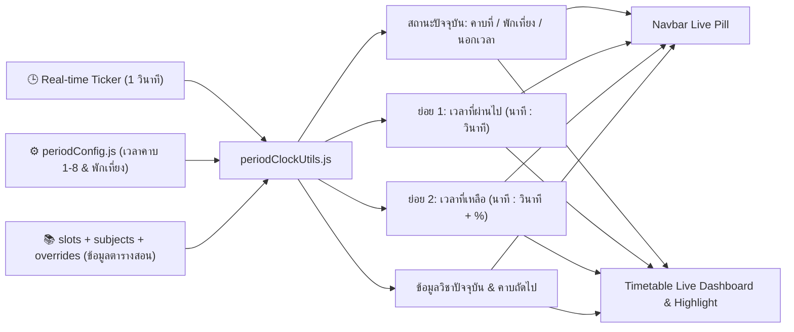

# 🕒 แผนแนวคิดและต่อยอด: ระบบนาฬิกา Real-Time และตัวจับเวลาคาบเรียนอัจฉริยะ (Smart Period Clock & Live Tracker)

> **สถานะ**: บันทึกแนวคิดและแผนการพัฒนา (Idea & Implementation Plan) — รอตรวจสอบก่อนเริ่มพัฒนาจริง  
> **วันที่บันทึก**: 3 พฤศจิกายน 2026  
> **โปรเจกต์**: EDcalendar (Teaching Schedule & Calendar Management)

---

## 🎯 1. แนวคิดหลักจากผู้ใช้งาน (Core Idea)

เพิ่ม **ระบบนาฬิกาแบบ Real-time** เข้าไปในระบบ EDcalendar โดยมีองค์ประกอบหลัก 3 ส่วนที่ทำงานสอดคล้องกันระดับวินาที:
1. **เวลาปัจจุบันแบบ Real-time (Live Clock)**: แสดงเวลา `ชั่วโมง:นาที:วินาที` ตามเวลาจริง
2. **ข้อมูลย่อยที่ 1 — เวลาที่เริ่มไปแล้ว (Elapsed Time)**: บอกว่าขณะนี้อยู่ใน **คาบไหน** และ **เริ่มคาบนี้ไปแล้วกี่นาที กี่วินาที**
3. **ข้อมูลย่อยที่ 2 — เวลาที่เหลืออยู่ (Remaining Time)**: บอกว่าในคาบปัจจุบัน **เหลือเวลาอีกกี่นาที กี่วินาที** ก่อนหมดคาบ

---

## 💡 2. การคิดต่อยอดไอเดีย (Brainstormed Enhancements)

เพื่อให้ระบบนาฬิกาไม่ได้เป็นเพียงตัวเลขบอกเวลาทั่วไป แต่เป็นผู้ช่วยหน้าห้องเรียนที่รู้ใจคุณครู จึงต่อยอดให้เชื่อมโยงกับข้อมูลตารางสอนและปฏิทินที่มีอยู่ในระบบ ดังนี้:

### 2.1 เชื่อมโยงข้อมูลวิชาที่กำลังสอนอัตโนมัติ (Context-Aware Period Matching)
* **ดึงข้อมูลจากตารางสอนจริง**: นอกจากบอกว่า *"คาบที่ 2"* แล้ว ระบบจะตรวจสอบตารางสอนของวันนั้น (`slots`, `subjects`) และข้อมูลปฏิทินรายวัน (`overrides`) เพื่อแสดงรายละเอียดทันที เช่น:
  * 🟢 **กรณีมีสอน**: `คาบที่ 2 • ว21101 วิทยาศาสตร์พื้นฐาน (ม.1/1 • ห้อง 302)`
  * ⚪ **กรณีคาบว่าง**: `คาบที่ 3 • คาบว่าง (ไม่มีตารางสอน)`
  * 🍱 **กรณีพักเที่ยง**: `พักเที่ยง (12:00 - 13:00 น.) • เริ่มพักไปแล้ว XX นาที XX วินาที / เหลือเวลาพักอีก XX นาที XX วินาที`
  * 🏕️ **กรณีคาบกิจกรรม (คาบ 7)**: ดึงชื่อกิจกรรมประจำวันอัตโนมัติ (แนะแนว, คุณธรรม, ลูกเสือ-เนตรนารี, ชุมนุม, 5 ส)
  * 📅 **กรณีวันนั้นมีบันทึกพิเศษในปฏิทิน**: หากวันนั้นทำเครื่องหมายว่า *"งดสอน"* หรือมี *"กิจกรรมโรงเรียน"* หรือมี *"สอนชดเชย"* ระบบจะแสดงสถานะตามจริงของวันนั้น

### 2.2 รองรับวิชาที่สอนควบหลายคาบ (Multi-Period Span Support)
* หากคุณครูสอนวิชาปฏิบัติการควบ 2 คาบติดกัน (เช่น คาบ 2–3 เวลา `09:30 - 11:10` รวม 100 นาที):
  * ระบบสามารถแสดงได้ทั้ง **เวลาของคาบย่อยปัจจุบัน** (คาบที่ 2) และ **เวลารวมของวิชาที่ควบ** (เริ่มวิชาไปแล้วกี่นาที / เหลือเวลาสอนวิชานี้อีกกี่นาที) เพื่อบริหารเวลาสอนต่อเนื่องได้แม่นยำ

### 2.3 ระบบบอก "คาบถัดไป" ล่วงหน้า (Up Next Preview)
* ช่วยให้คุณครูเตรียมตัวก่อนเดินเปลี่ยนห้องเรียน:
  * แสดงข้อความสั้นๆ ต่อท้าย เช่น `⏭️ คาบถัดไป (คาบ 3 • 10:20 น.): คณิตศาสตร์ • ม.2/3 • ห้อง 204`
  * **ช่วงเช้าก่อนเริ่มคาบ 1 (เช่น 08:00 - 08:40 น.)**: แสดงเวลานับถอยหลังก่อนเริ่มคาบที่ 1 (`⏳ อีก 23 นาที 45 วินาที จะเริ่มคาบที่ 1`)
  * **หลังเลิกเรียน (หลังคาบ 8) หรือวันเสาร์-อาทิตย์**: แสดงสถานะ `🌙 นอกเวลาเรียน / สิ้นสุดการสอนวันนี้แล้ว` พร้อมสรุปวิชาแรกของวันถัดไป

### 2.4 แถบความคืบหน้าและสีเตือนจังหวะการสอน (Visual Progress Bar & Pacing Color)
* มีหลอด Progress Bar วิ่งจาก `0%` ไปถึง `100%` ตามสัดส่วนวินาทีของคาบเรียน
* **สีเปลี่ยนอัตโนมัติตามเวลาที่เหลือ**:
  * 🟦 **สีคราม/เขียว (เหลือมากกว่า 10 นาที)**: ช่วงเวลาสอนตามปกติ
  * 🟨 **สีเหลืองอำพัน (เหลือ 5 – 10 นาที)**: เตือนให้เริ่มสรุปบทเรียนหรือมอบหมายงานท้ายคาบ
  * 🟥 **สีชมพู/แดง (เหลือน้อยกว่า 3 นาที)**: เตือนท้ายคาบ เตรียมปล่อยชั้นเรียนหรือสลับห้อง

### 2.5 ไฮไลต์ช่องตารางสอนปัจจุบันแบบสดๆ (Live Cell Highlight บนตาราง)
* ในหน้า **ตารางสอนประจำสัปดาห์** (`TimetableGrid`):
  * หัวคอลัมน์ของคาบปัจจุบันจะมีจุดไฟกะพริบสีเขียว `● LIVE`
  * ช่องวิชาที่ตรงกับ **วันปัจจุบัน + คาบปัจจุบัน** จะมีกรอบเรืองแสงเด่นชัดกว่าช่องอื่น เพื่อให้กวาดสายตามองตารางแล้วรู้ทันทีว่าตอนนี้อยู่ตรงไหน

### 2.6 โหมดนาฬิกาเต็มจอหน้าห้องเรียน (Classroom Fullscreen Timer — ฟีเจอร์เสริม)
* มีปุ่มกดขยายนาฬิกาเป็น **โหมดเต็มจอ (Fullscreen Mode)** สำหรับเวลาคุณครูเปิดคอมพิวเตอร์ต่อโปรเจกเตอร์/สมาร์ททีวีหน้าห้องเรียนขณะให้นักเรียนทำแบบฝึกหัดหรือสอบย่อยในคาบ
* แสดงตัวเลขเวลาปัจจุบัน เวลาที่ผ่านไป และเวลาที่เหลือขนาดใหญ่ มองเห็นชัดจากหลังห้องเรียน

---

## 🖥️ 3. การออกแบบตำแหน่งการแสดงผล (UI Layout & Placement)

ออกแบบให้มี 2 จุดหลักที่ทำงานร่วมกันโดยไม่รกสายตา:

### จุดที่ 1: แถบสถานะย่อบนเมนูด้านบน (Compact Live Pill บน `Navbar.jsx`)
* แสดงผลตลอดเวลาไม่ว่าจะอยู่หน้าตารางสอน ปฏิทิน หรือสรุปผล
* รูปแบบกะทัดรัด: `[ 🕒 10:16:45 | คาบ 2 • เหลือ 03:15 น. ]`
* เมื่อคลิกหรือนำเมาส์ไปชี้ (Hover) จะแสดงการ์ด Popover รายละเอียดเต็ม (เริ่มไปกี่นาที กี่วินาที / เหลืออีกกี่นาที กี่วินาที / วิชาที่สอน / คาบถัดไป)

### จุดที่ 2: การ์ดแดชบอร์ดเวลาสดในหน้าตารางสอน (Live Period Banner ใน `TimetableGrid.jsx`)
* วางไว้ด้านบนของตารางสอน แบ่งออกเป็น 3 ส่วนชัดเจนตามไอเดียของคุณครู:
  1. **บล็อกนาฬิกาหลัก (Real-time Clock)**: แสดงเวลา `10:16:45 น.` พร้อมวันและวันที่ไทย
  2. **บล็อกย่อยที่ 1 (เวลาที่เริ่มไปแล้ว)**: แสดง `คาบที่ 2 (09:30 - 10:20) • เริ่มไปแล้ว 46 นาที 45 วินาที`
  3. **บล็อกย่อยที่ 2 (เวลาที่เหลืออยู่)**: แสดง `เหลือเวลาอีก 03 นาที 15 วินาที` คู่กับหลอด Progress Bar และข้อมูลวิชา/ห้องเรียน

---

## ⚙️ 4. โครงสร้างทางเทคนิคและการคำนวณ (Technical Architecture)

### สูตรการคำนวณระดับวินาที
* แปลงเวลาปัจจุบันเป็นวินาทีนับจากเที่ยงคืน:
  $$\text{currentSeconds} = (\text{hours} \times 3600) + (\text{minutes} \times 60) + \text{seconds}$$
* แปลง `startTime` และ `endTime` ของแต่ละคาบใน [`periodConfig.js`](file:///w:/Ai/EDcalendar/src/utils/periodConfig.js) เป็นวินาที:
  $$\text{startSeconds} = (H_{\text{start}} \times 3600) + (M_{\text{start}} \times 60)$$
  $$\text{endSeconds} = (H_{\text{end}} \times 3600) + (M_{\text{end}} \times 60)$$
* เมื่อ $\text{startSeconds} \le \text{currentSeconds} < \text{endSeconds}$:
  * **เวลาที่เริ่มไปแล้ว (Elapsed)**: $\Delta_{\text{elapsed}} = \text{currentSeconds} - \text{startSeconds}$ แปลงเป็น `X นาที Y วินาที`
  * **เวลาที่เหลือ (Remaining)**: $\Delta_{\text{remain}} = \text{endSeconds} - \text{currentSeconds}$ แปลงเป็น `X นาที Y วินาที`
  * **เปอร์เซ็นต์ความคืบหน้า**: $\text{progress} = \frac{\Delta_{\text{elapsed}}}{\text{endSeconds} - \text{startSeconds}} \times 100$

---

## 🛠️ 5. แผนขั้นตอนการพัฒนาเมื่อพร้อมเริ่มงาน (Implementation Phases)

* **เฟสที่ 1: สร้างโมดูลคำนวณเวลาและคาบเรียน (`src/utils/periodClockUtils.js` & Hook `useRealtimePeriodClock`)**
  * สร้างฟังก์ชันคำนวณเวลาจริงระดับวินาที เทียบกับ `periods` ที่ตั้งค่าไว้
  * คำนวณค่า `elapsed` (นาที/วินาทีที่ผ่านไป), `remaining` (นาที/วินาทีที่เหลือ), `progressPercent`, คาบปัจจุบัน และคาบถัดไป
* **เฟสที่ 2: สร้างคอมโพเนนต์การ์ดนาฬิกาในหน้าตารางสอน (`src/components/Timetable/LivePeriodBanner.jsx`)**
  * แสดงเวลา Real-time + ย่อยที่ 1 (เริ่มไปกี่นาที กี่วินาที) + ย่อยที่ 2 (เหลืออีกกี่นาที กี่วินาที) + หลอดความคืบหน้า + ชื่อวิชา/ห้องเรียน
  * ไฮไลต์ช่องคาบปัจจุบันบนตาราง [`TimetableGrid.jsx`](file:///w:/Ai/EDcalendar/src/components/Timetable/TimetableGrid.jsx)
* **เฟสที่ 3: เพิ่มแถบนาฬิกาย่อบนแถบนำทางด้านบน (`Navbar.jsx`) และโหมดเต็มจอ (Fullscreen Clock Modal)**
  * เพิ่มป้ายบอกเวลาแบบ Compact บน [`Navbar.jsx`](file:///w:/Ai/EDcalendar/src/components/Navbar.jsx) พร้อม Popover
  * เพิ่มปุ่มเปิดนาฬิกาเต็มจอสำหรับฉายขึ้นโปรเจกเตอร์ในห้องเรียน
* **เฟสที่ 4: เพิ่มตัวเลือกตั้งค่าใน `SettingsModal.jsx`**
  * ตัวเลือกเปิด/ปิดการแสดงแถบนาฬิกา หรือตั้งค่าการแสดงผลสำหรับวิชาควบหลายคาบ
