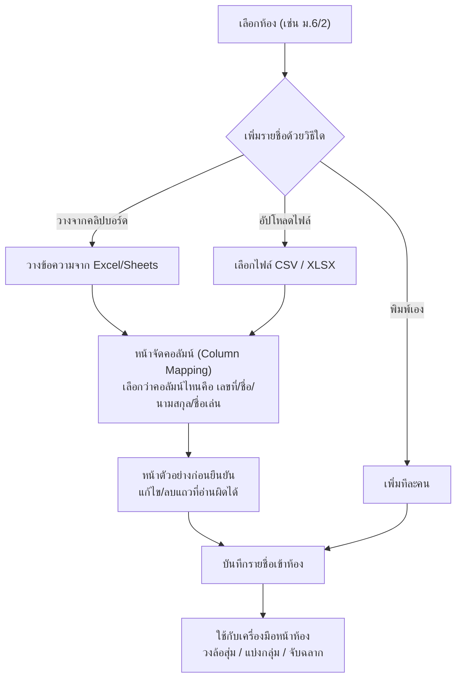

# 🎡 แผนแนวคิด: ระบบอัปโหลดรายชื่อนักเรียนต่อห้อง และเครื่องมือเกมหน้าห้องเรียน (Student Roster & Classroom Games)

> **สถานะ**: บันทึกแนวคิดและแผนการพัฒนา (Idea & Implementation Plan) — รอผู้ใช้งานสั่งเริ่มพัฒนา  
> **วันที่บันทึก**: 19 พฤศจิกายน 2026  
> **โปรเจกต์**: EDcalendar (Teaching Schedule & Calendar Management)

---

## 🎯 1. ที่มาและเป้าหมาย (Problem & Goal)

ปัจจุบัน EDcalendar รู้จักเพียง "ห้อง" (`gradeGroup` เช่น ม.6/2) ของแต่ละวิชา แต่ยังไม่รู้ว่าในห้องนั้นมีนักเรียนใครบ้าง ทำให้ทำกิจกรรมที่ต้องใช้รายชื่อไม่ได้
* **เป้าหมาย**: ให้ครู **อัปโหลดรายชื่อนักเรียนของแต่ละห้อง** เข้าระบบได้ง่ายที่สุด เพื่อเป็นฐานข้อมูลสำหรับฟีเจอร์เสริมหน้าห้องเรียน เช่น **วงล้อสุ่มรายชื่อ** ตอบคำถามในห้อง แบ่งกลุ่ม และจับฉลากลำดับ

---

## ✅ 2. การตัดสินใจที่ได้ข้อสรุปแล้ว (Decisions)

| หัวข้อ | ข้อสรุป |
|---|---|
| ช่องทางเพิ่มรายชื่อ | **ทำครบทั้ง 3 ช่องทาง**: วางจากคลิปบอร์ด, อัปโหลด CSV/Excel, พิมพ์เพิ่มทีละคน |
| การเก็บข้อมูล | **ซิงก์ขึ้นคลาวด์ได้** โดยต้องทำ **ระบบยืนยันตัวตนให้เรียบร้อยก่อน** (ดูหัวข้อ 5) |
| เกมหน้าห้อง | **ทำทุกไอเดีย** ในกลุ่มเกม (วงล้อ, สุ่มยุติธรรม, แบ่งกลุ่ม, จับฉลากลำดับ, ต่อตัวจับเวลา) |
| เช็กชื่อ/ติดตามรายคน (กลุ่ม B) | **ยังไม่ทำตอนนี้** เก็บไว้พิจารณาภายหลัง |
| รูปแบบไฟล์ Excel | **ต้องรองรับ Excel ได้ทุกแบบ** โดยมีขั้นตอน **จัดคอลัมน์เอง (Column Mapping)** ก่อนนำเข้า |

---

## 💡 3. ฟีเจอร์ที่ต้องมี (Key Features)



### 3.1 การนำเข้ารายชื่อ (Roster Import)

**ช่องทางที่ 1: วางจากคลิปบอร์ด (Copy–Paste)**
* ช่องข้อความเดียว รองรับข้อมูลที่คัดลอกจาก Excel / Google Sheets (คั่นด้วย Tab) หรือพิมพ์ทีละบรรทัด
* ถ้ามีหลายคอลัมน์ ให้เข้าสู่ขั้นตอนจัดคอลัมน์ ถ้ามีคอลัมน์เดียว ถือเป็น "ชื่อ" ทันที

**ช่องทางที่ 2: อัปโหลดไฟล์ CSV / Excel (.xlsx)**
* รองรับไฟล์ทะเบียนของโรงเรียนที่มีรูปแบบต่างกัน
* รองรับไฟล์ที่มีหลายชีต (Sheet) ให้เลือกชีตที่ต้องการ
* รองรับหัวตารางที่ไม่ได้อยู่แถวแรก (มีชื่อโรงเรียน/ชื่อห้องคั่นอยู่ด้านบน) ให้ผู้ใช้เลือกแถวเริ่มต้นเอง

**ช่องทางที่ 3: พิมพ์หรือเพิ่มทีละคน**
* ใช้สำหรับนักเรียนย้ายเข้า/ออกกลางเทอม หรือแก้ชื่อรายคน มีปุ่มลบและเรียงลำดับใหม่ได้

### 3.2 หน้าจัดคอลัมน์ก่อนอัปโหลด (Column Mapping) — ข้อกำหนดสำคัญ
เพื่อให้รองรับ Excel ทุกแบบ ผู้ใช้ต้องปรับแต่งได้ก่อนนำเข้า:
* ระบบ **เดาคอลัมน์ให้อัตโนมัติ** จากหัวตาราง เช่น "เลขที่", "รหัสนักเรียน", "ชื่อ", "ชื่อ-สกุล", "นามสกุล", "ชื่อเล่น" แต่ผู้ใช้เปลี่ยนได้เสมอ
* แต่ละคอลัมน์ในไฟล์เลือกได้ว่าเป็น: **เลขที่ / รหัสนักเรียน / คำนำหน้า / ชื่อ / นามสกุล / ชื่อ-นามสกุล (รวม) / ชื่อเล่น / ไม่ใช้**
* **แยกชื่อ-นามสกุลอัตโนมัติ** ถ้าไฟล์ใส่มาในช่องเดียว (ตัดตามช่องว่าง) และตัดคำนำหน้า (เด็กชาย/เด็กหญิง/นาย/นางสาว/ด.ช./ด.ญ.) ได้ตามตัวเลือก
* เลือกข้ามแถวหัวตาราง/แถวว่าง และกำหนดแถวเริ่มต้นข้อมูล
* จำค่าการจัดคอลัมน์ล่าสุดไว้ใช้กับไฟล์ถัดไป (เช่น ใช้ไฟล์รูปแบบเดียวกันทุกห้อง)
* **หน้าตัวอย่างก่อนยืนยัน**: แสดงรายชื่อที่จะนำเข้า พร้อมเตือนชื่อซ้ำ/แถวว่าง/ช่องที่ขาด และแก้ไขในหน้านั้นได้

### 3.3 เครื่องมือเกมหน้าห้อง (Classroom Games) — เปิดใช้ในโหมดนาฬิกาเต็มจอ
* 🎡 **วงล้อสุ่มชื่อ**: แอนิเมชันหมุน + เสียง แสดงบนจอใหญ่
* ⚖️ **สุ่มแบบยุติธรรม**: คนที่ถูกสุ่มแล้วไม่ถูกสุ่มซ้ำจนครบรอบ มีตัวเลือกข้ามคนที่ไม่มา และปุ่มรีเซ็ตรอบ
* 👥 **แบ่งกลุ่มอัตโนมัติ**: ระบุ "จำนวนกลุ่ม" หรือ "จำนวนคนต่อกลุ่ม" เลือกสุ่มหรือคละตามเลขที่ แสดงผลบนจอใหญ่
* 🎯 **จับฉลากลำดับ**: จัดลำดับการนำเสนอ/การตอบคำถามแบบสุ่ม
* ⏱️ **เชื่อมกับตัวจับเวลากิจกรรม**: สุ่มคนแล้วเริ่มจับเวลาตอบทันที
* ตัวเลือกการแสดงผล: เลือกแสดง **ชื่อเล่น / เลขที่ / ชื่อเต็ม** และโหมดซ่อนนามสกุล เพื่อความเป็นส่วนตัวบนจอใหญ่

---

## 🔐 4. เรื่องความเป็นส่วนตัวและความปลอดภัย (Privacy & Security)

ชื่อนักเรียนเป็นข้อมูลส่วนบุคคล (เกี่ยวข้องกับ PDPA) การเลือกซิงก์ขึ้นคลาวด์จึงมีเงื่อนไข:
* **ต้องทำระบบยืนยันตัวตนให้เรียบร้อยก่อนเปิดใช้ซิงก์รายชื่อ** ปัจจุบันระบบยังเรียก Firestore จาก browser โดยตรงโดยไม่มีการยืนยันตัวตน และฟังก์ชันรีเซ็ตรหัสผ่านยังตั้งรหัสใหม่ให้บัญชีใดก็ได้โดยไม่ยืนยันตัวตน (ดู "งานที่ต้องทำก่อน" ด้านล่าง)
* รายชื่อควรเข้าถึงได้เฉพาะเจ้าของบัญชีครูเท่านั้น (ตั้งกฎสิทธิ์ฝั่งฐานข้อมูล ไม่พึ่งการเช็กฝั่ง browser)
* ระหว่างรอระบบยืนยันตัวตน ให้เก็บรายชื่อ **เฉพาะในเครื่อง (localStorage)** ไปก่อน และมีปุ่มส่งออก/นำเข้าไฟล์สำรอง
* มีปุ่ม **ลบรายชื่อทั้งห้อง** และลบรายชื่อทั้งหมดได้ในหน้าตั้งค่า
* ไม่เก็บข้อมูลที่ไม่จำเป็น (เช่น เลขบัตรประชาชน) ถ้าไฟล์มีคอลัมน์ที่ไม่ใช้ ให้ทิ้งทันที ไม่นำเข้า

### งานที่ต้องทำก่อน (Prerequisite)
1. ย้ายระบบบัญชีไปใช้ **Supabase Auth** ให้เต็มรูปแบบ แทนการเทียบรหัสฝั่ง browser และเลิกใช้ Firestore แบบไม่ยืนยันตัวตน
2. ตั้ง **Row-Level Security** ให้ข้อมูลของครูแต่ละคนเข้าถึงได้เฉพาะเจ้าของ
3. วางแผนย้ายบัญชีเดิมโดยไม่ทำให้ผู้ใช้เข้าไม่ได้

---

## 🛠️ 5. โครงข้อมูลและไฟล์ที่คาดว่าจะแก้ไข (Data Model & Files)

**โครงข้อมูลเบื้องต้น** (ผูกกับห้อง ไม่ผูกกับวิชา เพื่อใช้ซ้ำได้ทุกวิชาที่สอนห้องเดียวกัน)
```
rosters: [
  {
    id, semesterId, classGroup: "ม.6/2",
    students: [{ id, number, studentCode?, prefix?, firstName, lastName?, nickname? }],
    updatedAt
  }
]
```

1. **`src/services/storage.js` / `sampleData.js`**: เพิ่มข้อมูล `rosters` ในโครงข้อมูลหลัก (และใน hash ซิงก์)
2. **`src/components/Roster/RosterManagerModal.jsx`** (ใหม่): หน้าจัดการรายชื่อต่อห้อง
3. **`src/components/Roster/RosterImportWizard.jsx`** (ใหม่): วางข้อความ/อัปโหลดไฟล์ → จัดคอลัมน์ → ตัวอย่าง → ยืนยัน
4. **`src/utils/rosterParser.js`** (ใหม่): แยกข้อความ Tab/CSV, เดาคอลัมน์, แยกชื่อ-นามสกุล, ตัดคำนำหน้า
5. **ไลบรารีอ่าน Excel** (เช่น SheetJS) สำหรับ `.xlsx` — ควรโหลดแบบ lazy เพื่อไม่ให้ไฟล์หลักใหญ่ขึ้น
6. **`src/components/Timetable/LivePeriodTracker.jsx`**: เพิ่มปุ่มเครื่องมือเกมในโหมดนาฬิกาเต็มจอ (วงล้อ, แบ่งกลุ่ม, จับฉลาก) โดยดึงรายชื่อตามห้องของคาบปัจจุบัน
7. **`src/components/Classroom/`** (ใหม่): `SpinWheel`, `GroupMaker`, `OrderDraw` และส่วนเชื่อมกับตัวจับเวลากิจกรรม

---

## 🧭 6. ลำดับการพัฒนาที่แนะนำ (Roadmap)

1. **เฟส 0 — พื้นฐานความปลอดภัย**: ระบบยืนยันตัวตน (Supabase Auth) + กฎสิทธิ์ข้อมูล
2. **เฟส 1 — รายชื่อต่อห้อง**: โครงข้อมูล + ทั้ง 3 ช่องทางนำเข้า + หน้าจัดคอลัมน์ + ตัวอย่างก่อนยืนยัน (เก็บในเครื่องก่อนได้ระหว่างรอเฟส 0)
3. **เฟส 2 — เกมหน้าห้อง**: วงล้อ, สุ่มยุติธรรม, แบ่งกลุ่ม, จับฉลากลำดับ, เชื่อมตัวจับเวลา
4. **เฟส 3 — ซิงก์รายชื่อขึ้นคลาวด์**: เปิดเมื่อเฟส 0 เสร็จและทดสอบสิทธิ์แล้ว

---

## 🚫 7. สิ่งที่ยังไม่ทำ (Out of Scope for Now)

* **เช็กชื่อรายคาบ / สถิติการเข้าเรียน / คะแนนเก็บ / บันทึกสั้นรายคน** (กลุ่ม B) — ผู้ใช้ขอเลื่อนไว้ก่อน
* ผังที่นั่ง, ตารางอันดับทีม, ออกเสียงอ่านชื่อ — เก็บเป็นไอเดียสำรอง

---

## ❓ 8. ประเด็นที่ยังเปิดอยู่ (Open Questions)

* ไฟล์ทะเบียนของโรงเรียนจริงมีรูปแบบอย่างไร (ทดสอบ Column Mapping กับตัวอย่างจริง 2–3 ไฟล์)
* ต้องการให้ครูหลายคนที่สอนห้องเดียวกันแชร์รายชื่อกันได้หรือไม่ (ถ้าใช่ ต้องออกแบบสิทธิ์แบบแชร์เพิ่ม)
* ต้องการเก็บ "รหัสนักเรียน" ด้วยหรือไม่ หรือใช้แค่เลขที่และชื่อ
* ระหว่างรอเฟส 0 จะเปิดให้ใช้รายชื่อแบบเก็บในเครื่องก่อนหรือรอให้ระบบยืนยันตัวตนเสร็จทั้งหมด
