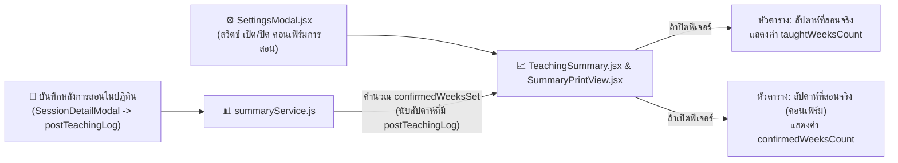

# ✅ แผนแนวคิด: ปรับปรุงตารางสรุปผลการสอน และเพิ่ม "ระบบคอนเฟิร์มการสอน" (Teaching Confirmation System)

> **สถานะ**: พัฒนาและติดตั้งเข้าสู่ระบบเรียบร้อยแล้ว (Implemented & Active)  
> **วันที่บันทึก**: 3 พฤศจิกายน 2026 (อัปเดตและพัฒนาเสร็จสิ้น: 4 พฤศจิกายน 2026)  
> **โปรเจกต์**: EDcalendar (Teaching Schedule & Calendar Management)

---

## 🎯 1. โจทย์และความต้องการหลัก (Core Requirements)

1. **นำคอลัมน์ `ตามแผน` และ `สอนจริง` (จำนวนคาบ) ออกจากตารางสรุปรายวิชา**:
   * ในหน้าสรุปผลการสอน ([`TeachingSummary.jsx`](file:///w:/Ai/EDcalendar/src/components/Summary/TeachingSummary.jsx)) และหน้ารายงานพิมพ์ ([`SummaryPrintView.jsx`](file:///w:/Ai/EDcalendar/src/components/Summary/SummaryPrintView.jsx)) ให้ตัด 2 ช่องนี้ออก เพื่อให้ตารางเน้นที่จำนวนสัปดาห์และสถานะสำคัญโดยไม่ซ้ำซ้อน
2. **เพิ่มฟีเจอร์ใหม่: "ระบบคอนเฟิร์มการสอน" (Teaching Confirmation)**:
   * **เปิด–ปิดได้ในหน้าตั้งค่า ([`SettingsModal.jsx`](file:///w:/Ai/EDcalendar/src/components/Settings/SettingsModal.jsx))**: มีสวิตช์สำหรับเปิดหรือปิดใช้งานฟีเจอร์นี้ได้ตลอดเวลา
   * **แสดงผลแทนช่อง `สัปดาห์ที่สอนจริง`**:
     * เมื่อ **ปิด** ฟีเจอร์: หัวตารางแสดง `สัปดาห์ที่สอนจริง` และคำนวณตามตารางปกติเหมือนเดิม
     * เมื่อ **เปิด** ฟีเจอร์: หัวตารางจะมีวงเล็บสั้นๆ ต่อท้ายเป็น **`สัปดาห์ที่สอนจริง (คอนเฟิร์ม)`**
   * **คำนวณจากคาบที่มีการ "บันทึกหลังการสอน" (`postTeachingLog`)**:
     * คาบเรียนใดที่มีการกดบันทึกหลังการสอนเรียบร้อยแล้ว ระบบจะนับว่าคาบ/สัปดาห์นั้น **"คอนเฟิร์มการสอนแล้ว"**
     * ตัวเลขในช่องจะแสดงว่า **แต่ละวิชาคอนเฟิร์มการสอนไปแล้วกี่สัปดาห์**

---

## ⚙️ 2. รายละเอียดการทำงานและตรรกะการคำนวณ (Calculation Logic)

### 2.1 การตรวจจับการคอนเฟิร์มใน [`summaryService.js`](file:///w:/Ai/EDcalendar/src/services/summaryService.js)
* ในแต่ละรายวิชา (`subjectStats[subId]`) จะเพิ่มตัวแปรเก็บชุดสัปดาห์ที่คอนเฟิร์มแล้ว:
  * `confirmedWeeksSet: new Set()`
  * `confirmedCount: 0` (จำนวนคาบที่บันทึกหลังการสอนแล้ว)
* เมื่อวนลูปตรวจสอบคาบเรียน (`sess`) ในแต่ละวันเรียน:
  * เช็กว่า `(sess.status === 'normal' || sess.status === 'makeup')` และมีข้อมูล `sess.postTeachingLog && sess.postTeachingLog.trim() !== ''`
  * หากมีบันทึกหลังการสอนแล้ว ให้เพิ่ม `weekKey` ของสัปดาห์นั้นเข้าสู่ `stat.confirmedWeeksSet.add(weekKey)` และ `allConfirmedWeeksSet.add(weekKey)`
* สรุปผลออกเป็น `confirmedWeeksCount: s.confirmedWeeksSet.size` และ `totalConfirmedWeeks: allConfirmedWeeksSet.size`

### 2.2 การแสดงผลในตารางสรุปผลการสอน ([`TeachingSummary.jsx`](file:///w:/Ai/EDcalendar/src/components/Summary/TeachingSummary.jsx))
* **ลบ 2 คอลัมน์**:
  * ลบ `<th>ตามแผน</th>` และ `<td>{item.plannedCount}</td>`
  * ลบ `<th>สอนจริง</th>` และ `<td>{item.completedCount}</td>`
* **คอลัมน์ `สัปดาห์ที่สอนจริง`**:
  * เมื่อ **เปิด** โหมดคอนเฟิร์มการสอน:
    * หัวตารางเปลี่ยนเป็น: `สัปดาห์ที่สอนจริง (คอนเฟิร์ม)`
    * ตัวเลขในตารางแสดง: `{item.confirmedWeeksCount}` (จำนวนสัปดาห์ที่บันทึกหลังการสอนแล้วของวิชานั้น)
  * เมื่อ **ปิด** โหมดคอนเฟิร์มการสอน:
    * หัวตารางแสดง: `สัปดาห์ที่สอนจริง`
    * ตัวเลขในตารางแสดง: `{item.taughtWeeksCount}` ตามปกติ

---

## 🛠️ 3. รายการไฟล์ที่จะแก้ไขเมื่อเริ่มพัฒนา (Files to Modify)

1. **[`src/services/summaryService.js`](file:///w:/Ai/EDcalendar/src/services/summaryService.js)**
   * เพิ่มการคำนวณ `confirmedWeeksSet`, `confirmedWeeksCount`, `totalConfirmedWeeks` จากคาบที่มี `postTeachingLog`
2. **[`src/components/Settings/SettingsModal.jsx`](file:///w:/Ai/EDcalendar/src/components/Settings/SettingsModal.jsx)**
   * เพิ่มตัวเลือกเปิด–ปิด **"ระบบคอนเฟิร์มการสอน (นับสัปดาห์สอนจริงจากบันทึกหลังการสอน)"** ในหมวด *การแสดงผล & ทั่วไป* พร้อมบันทึกค่าลง `localStorage` (`edcalendar_confirm_teaching_mode`)
3. **[`src/App.jsx`](file:///w:/Ai/EDcalendar/src/App.jsx)**
   * ส่งค่าสถานะ `confirmTeachingMode` ไปยัง `SettingsModal` และ `TeachingSummary`
4. **[`src/components/Summary/TeachingSummary.jsx`](file:///w:/Ai/EDcalendar/src/components/Summary/TeachingSummary.jsx)**
   * นำคอลัมน์ `ตามแผน` และ `สอนจริง` ออกจากตารางรายวิชา
   * ปรับหัวตาราง `สัปดาห์ที่สอนจริง` ให้มีวงเล็บ `(คอนเฟิร์ม)` เมื่อเปิดใช้งาน และสลับตัวเลขเป็นจำนวนสัปดาห์ที่คอนเฟิร์มแล้ว
5. **[`src/components/Summary/SummaryPrintView.jsx`](file:///w:/Ai/EDcalendar/src/components/Summary/SummaryPrintView.jsx)**
   * นำคอลัมน์ `ตามแผน` และ `สอนจริง` ออกจากตารางพิมพ์รายงาน และแสดงผล `สัปดาห์ที่สอนจริง (คอนเฟิร์ม)` ให้ตรงกับหน้าจอหลัก
