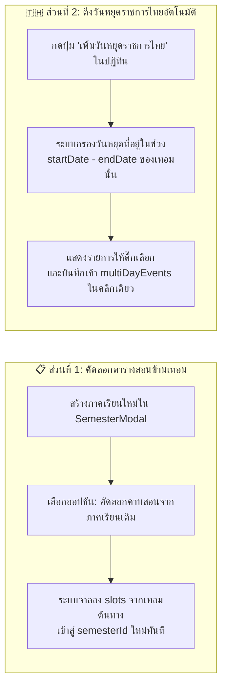

# 🇹🇭 แผนแนวคิด: ดึงวันหยุดราชการไทยอัตโนมัติ & คัดลอกตารางสอนข้ามภาคเรียน (Thai Holidays Preset & Semester Clone)

> **สถานะ**: พัฒนาและติดตั้งเข้าสู่ระบบเรียบร้อยแล้ว (Implemented & Active)  
> **วันที่บันทึก**: 4 พฤศจิกายน 2026  
> **โปรเจกต์**: EDcalendar (Teaching Schedule & Calendar Management)

---

## 🎯 1. ที่มาและปัญหาที่ต้องการแก้ไข (Problem & Goal)

ทุกครั้งที่เริ่มต้นภาคเรียนใหม่ (เช่น ขึ้นภาคเรียนที่ 1 หรือ ภาคเรียนที่ 2):
1. **การตั้งค่าวันหยุดประจำเทอม**: คุณครูต้องเปิดปฏิทินแล้วคอยกดเพิ่มวันหยุดราชการและวันสำคัญต่างๆ ทีละวันใน [`MultiDayEventModal.jsx`](file:///w:/Ai/EDcalendar/src/components/Calendar/MultiDayEventModal.jsx)
2. **การจัดตารางสอนเทอมใหม่**: ในหลายโรงเรียน ตารางสอนของเทอม 2 มักมีโครงสร้างใกล้เคียงกับเทอม 1 หรือคุณครูต้องการคัดลอกโครงตารางเดิมมาปรับแก้เพียงบางคาบ แต่ปัจจุบันเมื่อสร้างเทอมใหม่ใน [`SemesterModal.jsx`](file:///w:/Ai/EDcalendar/src/components/Semesters/SemesterModal.jsx) ตารางสอนจะเริ่มต้นเป็นตารางว่างเปล่า

---

## 💡 2. รายละเอียดฟีเจอร์ทั้ง 2 ส่วน (Key Features)

### 2.1 ระบบคัดลอกตารางสอนข้ามภาคเรียน (Semester Timetable Cloning)
* ในหน้าต่าง [`SemesterModal.jsx`](file:///w:/Ai/EDcalendar/src/components/Semesters/SemesterModal.jsx):
  * ขณะสร้างภาคเรียนใหม่ จะมีตัวเลือก Dropdown: **"คัดลอกโครงสร้างตารางสอนจากภาคเรียนที่มีอยู่ (ไม่บังคับ)"**
  * นอกจากนี้ สำหรับภาคเรียนที่สร้างไปแล้วแต่ยังไม่มีคาบสอน จะมีปุ่ม **"📋 ดึงตารางสอนจากภาคเรียนอื่น"**
  * สามารถเลือกได้ว่าจะคัดลอก **ทุกวิชา** หรือ **เฉพาะวิชาที่ตั้งค่าเป็น `ทั้ง 2 เทอม` และวิชาที่ตรงกับเทอมใหม่**

### 2.2 ระบบดึงวันหยุดราชการและวันสำคัญไทยอัตโนมัติ (Thai School Holidays Importer)
* สร้างฐานข้อมูลวันหยุดราชการไทย (`src/utils/thaiHolidays.js`) ครอบคลุมวันหยุดประจำปีและวันสำคัญทางการศึกษา เช่น:
  * **ภาคเรียนที่ 1 (พ.ค. – ต.ค.)**: วันพืชมงคล, วันวิสาขบูชา, วันเฉลิมพระชนมพรรษาสมเด็จพระนางเจ้าฯ พระบรมราชินี (3 มิ.ย.), วันอาสาฬหบูชา, วันเข้าพรรษา, วันเฉลิมพระชนมพรรษา ร.10 (28 ก.ค.), วันแม่แห่งชาติ (12 ส.ค.), วันคล้ายวันสวรรคต ร.9 (13 ต.ค.), วันปิยมหาราช (23 ต.ค.)
  * **ภาคเรียนที่ 2 (พ.ย. – มี.ค.)**: วันคล้ายวันพระบรมราชสมภพ ร.9 / วันพ่อแห่งชาติ (5 ธ.ค.), วันรัฐธรรมนูญ (10 ธ.ค.), วันหยุดสิ้นปีและวันขึ้นปีใหม่ (31 ธ.ค. – 1 ม.ค.), วันมาฆบูชา
* **การทำงาน**:
  * ระบบจะกรองเฉพาะวันหยุดที่ตรงกับช่วง `startDate` ถึง `endDate` ของภาคเรียนปัจจุบัน และตรงกับวันจันทร์–ศุกร์ (หรือรวมวันหยุดชดเชย)
  * แสดงหน้าต่างให้คุณครูติ๊กเลือกวันหยุดที่ต้องการนำเข้า (ติ๊กเลือกทั้งหมดเป็นค่าเริ่มต้น) แล้วกด **"นำเข้าวันหยุดที่เลือก"** เพื่อสร้างรายการใน `multiDayEvents` (ตั้งค่า `cancelClasses: true`) ทันที

---

## 🛠️ 3. รายการไฟล์ที่จะสร้างและแก้ไขเมื่อเริ่มพัฒนา (Files to Create/Modify)

1. **`src/utils/thaiHolidays.js` *(สร้างใหม่)***
   * เก็บรายการวันหยุดราชการไทยประจำปี (รองรับ พ.ศ. 2568–2571 และวันหยุดคงที่ประจำปี) พร้อมฟังก์ชันกรองวันหยุดตามช่วงวันที่ของภาคเรียน
2. **[`src/components/Semesters/SemesterModal.jsx`](file:///w:/Ai/EDcalendar/src/components/Semesters/SemesterModal.jsx)**
   * เพิ่มตัวเลือก **"คัดลอกตารางสอนจากภาคเรียน..."** ตอนสร้างภาคเรียนใหม่ และปุ่มคัดลอกตารางสอนระหว่างภาคเรียน
3. **[`src/components/Calendar/TeachingCalendar.jsx`](file:///w:/Ai/EDcalendar/src/components/Calendar/TeachingCalendar.jsx) & [`src/components/Calendar/MultiDayEventModal.jsx`](file:///w:/Ai/EDcalendar/src/components/Calendar/MultiDayEventModal.jsx)**
   * เพิ่มปุ่ม **"🇹🇭 ดึงวันหยุดราชการ"** เพื่อให้คุณครูเลือกนำเข้าวันหยุดประจำภาคเรียนได้ในคลิกเดียว
4. **[`src/App.jsx`](file:///w:/Ai/EDcalendar/src/App.jsx)**
   * เพิ่มฟังก์ชัน `handleCloneSemesterSlots` และ `handleBatchImportMultiDayEvents`
